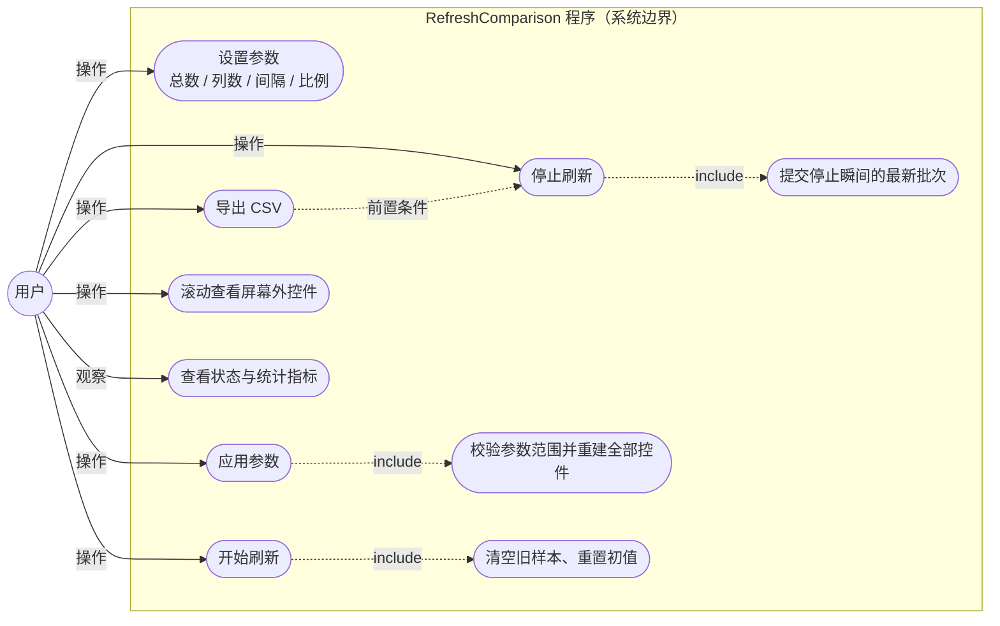
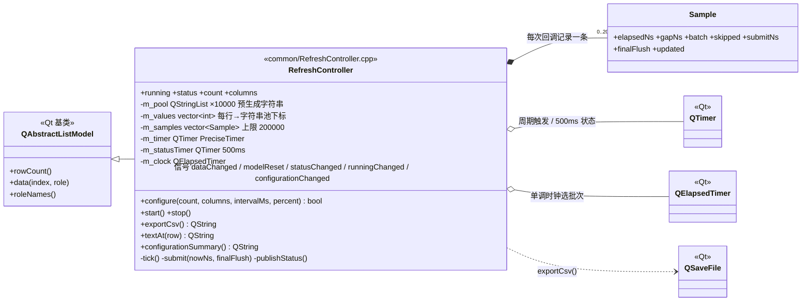
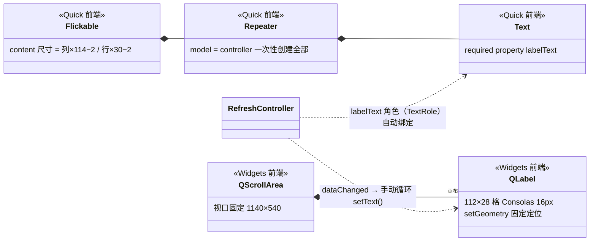
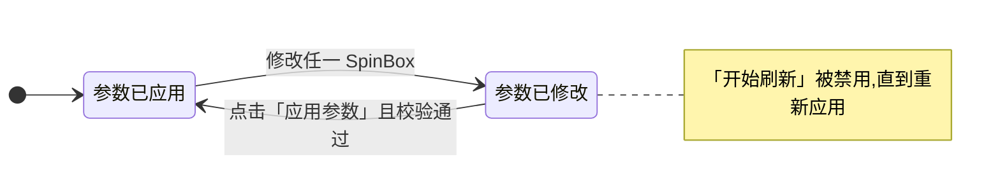
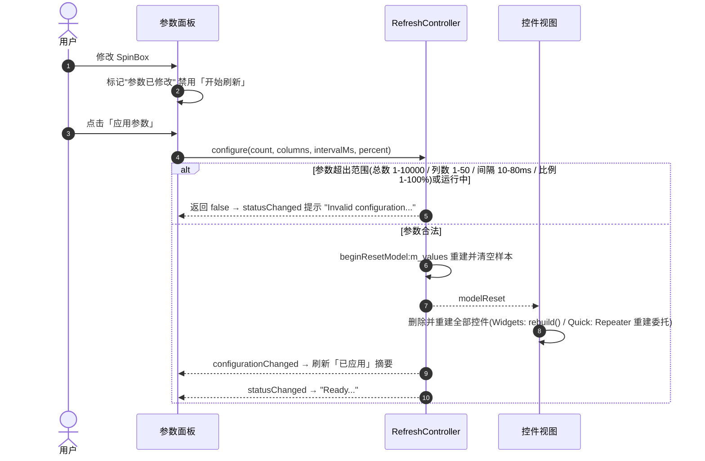
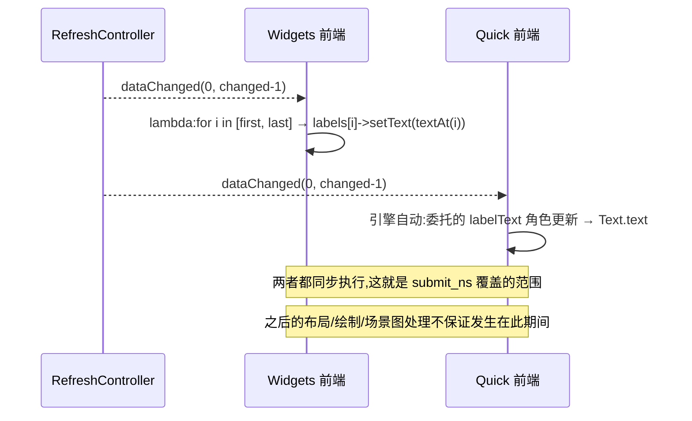
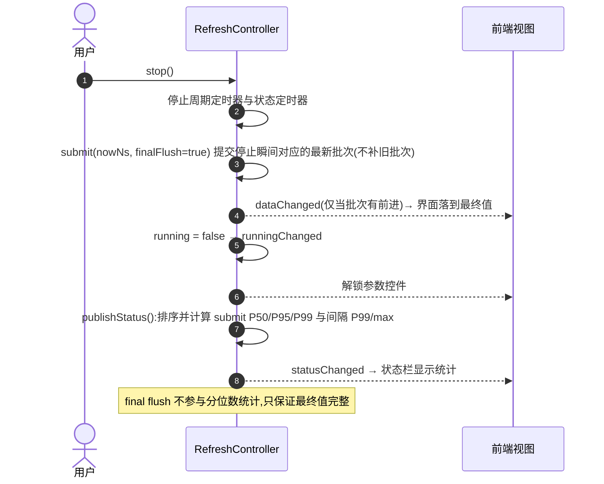

# RefreshComparison 架构与设计图

> 本项目的目标是**手动对照** Qt Widgets(QLabel)与 Qt Quick(Text)在批量文本刷新下的同步更新耗时与调度稳定性。两个前端共用同一套 C++ 数据驱动,保证负载定义一致。本文档用 Mermaid 图(用例图、类图、状态图、时序图)帮助理解代码结构。
>
> 渲染方式:GitHub 直接渲染;VS Code 安装 *Markdown Preview Mermaid Support* 插件;Typora 原生支持;或复制到 [mermaid.live](https://mermaid.live)。

## 阅读顺序建议

1. `README.md` —— 目标、参数含义、指标定义与局限(名词以它为准)
2. `common/RefreshController.h` —— 数据模型、属性与接口
3. `common/RefreshController.cpp` —— 核心驱动逻辑(定时、批次、采样、CSV)
4. `widgets/main.cpp` 与 `quick/main.cpp` + `quick/Main.qml` —— 两个前端对照
5. `CMakeLists.txt` —— 三个目标的构建关系

---

## 1. 组件架构图

三个 CMake 目标:静态库 `refresh_common` 被两个可执行文件各自链接,**两个程序永不并发运行**,靠相同配置分别采样后对比 CSV。

```mermaid
flowchart LR
    subgraph WEXE["widgets_refresh.exe"]
        WM["widgets/main.cpp<br/>QApplication + QScrollArea<br/>QLabel 固定网格"]
    end
    subgraph QEXE["quick_refresh.exe"]
        QM["quick/main.cpp<br/>QGuiApplication<br/>QQmlApplicationEngine"]
        QML["quick/Main.qml<br/>Flickable + Repeater<br/>Text 委托"]
    end
    subgraph LIB["refresh_common（静态库）"]
        RC["RefreshController<br/>QAbstractListModel<br/>定时驱动 + 采样 + CSV"]
        T["QTimer（Qt::PreciseTimer）"]
        FS["QSaveFile → Documents/RefreshComparison/*.csv"]
    end

    WM -->|"Q_INVOKABLE: configure/start/stop/exportCsv"| RC
    RC -->|"modelReset / dataChanged / statusChanged / runningChanged"| WM
    QM -->|setContextProperty("controller")| RC
    QML -->|"configure/start/stop/exportCsv"| RC
    RC -->|"labelText 角色绑定自动刷新"| QML
    RC --> T
    RC --> FS
```

要点:

- **模型是唯一数据源**:两端控件都不自产数据,值全部来自 `RefreshController::textAt(row)`。
- **同一条 `dataChanged` 信号,两端处理方式不同**:Widgets 端手动循环 `setText()`,Quick 端由 QML 引擎的角色绑定自动更新(见 §5.5)。
- CSV 导出逻辑在公共层,两端行为完全一致。

---

## 2. 用例图

系统边界为程序本身,参与者只有「用户」;虚线为 `include` 依赖与前置条件。



补充规则(来自代码):

- **修改参数不等于生效**:改 SpinBox 后必须点「应用参数」,否则「开始刷新」被禁用(Widgets 端由 `valueChanged` 禁用,Quick 端由 `settingsDirty` 控制)。
- **运行中参数锁定**:`configure()` 在 `m_running` 时直接返回 `false`。
- 应用参数或重新开始都会**清空旧样本**,导出前须先停止(`exportCsv()` 对运行中状态报错)。

---

## 3. 类图

### 3.1 公共核心



### 3.2 两个前端的视图结构



注意:两端都是**一次性创建全部对象**(Quick 用 Repeater 而非 ListView 虚拟化),视口外的对象依然存在——总数不能理解为可见数。

---

## 4. 状态图

### 4.1 运行状态机(RefreshController)

```mermaid
stateDiagram-v2
    direction LR
    [*] --> 就绪: 程序启动(构造时已用默认参数 300/10列/20ms/100% 自动 configure)
    就绪 --> 就绪: configure() 校验通过并重建
    就绪 --> 运行中: start()
    运行中 --> 运行中: tick() 提交当前时间对应的最新批次
    运行中 --> 已停止: stop() 或样本达到 200000 上限自动停止
    已停止 --> 运行中: start()(清空旧样本重新开始)
    已停止 --> 已停止: exportCsv() 导出样本
    note right of 运行中: 参数控件被禁用;迟到直接选最新批次,不补旧批次
    note right of 已停止: 状态栏显示 P50/P95/P99 与间隔统计;final flush 不计入分位数
```



### 4.2 参数编辑状态机(两个前端一致)



---

## 5. 时序图

### 5.1 启动与初始化

```mermaid
sequenceDiagram
    autonumber
    participant Main as main()
    participant RC as RefreshController
    participant UI as 前端窗口

    Main->>RC: new RefreshController("widgets" | "quick")
    RC->>RC: 预生成 10000 个八位数字字符串池(构造期一次性完成,不计入测量)
    RC->>RC: m_timer 设为 PreciseTimer;m_statusTimer 设为 500 ms
    RC->>RC: configure(300, 10, 20, 100) 默认参数自动应用
    alt Widgets 前端
        Main->>UI: 代码创建窗口与控件,connect 模型各信号
        Main->>UI: rebuild() 按默认参数创建 300 个 QLabel
    else Quick 前端
        Main->>UI: engine.load("qrc:/quick/Main.qml")
        UI->>RC: 读取 count / columns / configurationSummary / status
        UI->>UI: Repeater 依据模型创建 300 个 Text 委托
    end
    Main->>UI: window.show() 显示
```

### 5.2 应用参数(configure)



### 5.3 开始刷新(start)

```mermaid
sequenceDiagram
    autonumber
    actor U as 用户
    participant RC as RefreshController
    participant T as QTimer
    participant View as 控件视图

    U->>RC: start()
    RC->>RC: 清空旧样本;全部值重置为 i % 10000
    RC-->>View: dataChanged(0, count-1) → 全部控件恢复初始值
    RC->>T: 启动周期定时器(intervalMs)与 500ms 状态定时器
    RC->>T: m_clock 单调时钟重新计零
    RC-->>View: runningChanged → 禁用参数控件
    RC-->>View: statusChanged → 状态栏进入 Running
```

### 5.4 运行期刷新循环(核心)

```mermaid
sequenceDiagram
    participant T as QTimer(PreciseTimer)
    participant RC as RefreshController
    participant View as 前端视图

    loop 每 intervalMs 触发一次
        T->>RC: tick()
        alt 样本数已达 200000 上限
            RC->>RC: 自动 stop(),状态栏追加提示
        else 正常采样
            RC->>RC: submit(nowNs, false)
            RC->>RC: batch = nowNs ÷ 周期;updated = batch > 上次批次
            alt 跨入新批次
                RC->>RC: 前 ceil(count×percent/100) 行写入 (batch + row) % 10000
                RC-->>View: dataChanged(0, changed-1) 同步发出
                View->>View: 更新控件文本(两端机制见 5.5)
                Note over RC: 该同步段墙钟耗时记入 submit_ns
            else 批次未变化
                Note over RC: 不通知前端,该回调仅参与间隔统计
            end
            RC->>RC: 追加 Sample{elapsedNs, gapNs, batch, skipped, submitNs, updated}
        end
    end
```

### 5.5 同一条 dataChanged 在两个前端的不同处理



### 5.6 停止与最终提交(stop)



### 5.7 导出 CSV

```mermaid
sequenceDiagram
    autonumber
    actor U as 用户
    participant RC as RefreshController
    participant FS as 文件系统

    U->>RC: exportCsv()
    alt 仍在运行或没有样本
        RC-->>U: statusChanged "Stop a run before exporting samples."
    else 已停止且有样本
        RC->>FS: 创建 Documents/RefreshComparison 目录
        RC->>FS: QSaveFile 写入 <frontend>-<时间戳>-<uuid>.csv
        Note over RC,FS: 13 个字段表头 + 每样本一行;flush 后 commit
        RC-->>U: statusChanged "CSV saved: <完整路径>"
    end
```

---

## 6. 两个前端的差异对照

| 环节 | widgets_refresh | quick_refresh |
|---|---|---|
| 应用类 | `QApplication` | `QGuiApplication` + `QQmlApplicationEngine` |
| 视图容器 | `QScrollArea` + 画布 `QWidget` | `Flickable` |
| 文本控件 | `QLabel`(`setGeometry` 固定定位) | `Text`(Repeater 委托,x/y 定位) |
| 创建方式 | `rebuild()` 循环 new | Repeater 一次性创建(非虚拟化) |
| 更新通道 | `dataChanged` → lambda 循环 `setText()` | `labelText` 角色绑定自动更新 |
| 参数未应用标记 | SpinBox `valueChanged` 禁用 Start | `settingsDirty` 属性 |
| 状态栏 | `statusChanged` → lambda `setText()` | Label 绑定 `controller.status` |

---

## 7. 关键代码位置索引

| 机制 | 位置 |
|---|---|
| 字符串池预生成(10000 个八位串) | `common/RefreshController.cpp:17-19` |
| 角色名 `labelText` | `common/RefreshController.h:39-42` |
| 参数校验与模型重置 | `common/RefreshController.cpp:56-76` |
| 批次选择:最新值驱动、迟到不补 | `common/RefreshController.cpp:104-125` |
| 局部更新:固定前缀 `ceil(count×percent/100)` 行 | `common/RefreshController.cpp:113-117` |
| 样本上限 200000 自动停止 | `common/RefreshController.cpp:96-99` |
| 最终 flush 不参与分位数 | `common/RefreshController.cpp:153-158` |
| Widgets 端 `setText` 循环 | `widgets/main.cpp:98-102` |
| Quick 端 `labelText` 委托绑定 | `quick/Main.qml:126-140` |
| Quick 端 `settingsDirty` 逻辑 | `quick/Main.qml:13, 78-86` |
